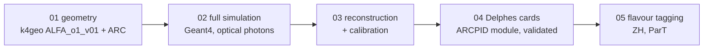

# ALFA-ARC

**Particle identification with the ARC (Array of RICH Cells) for the ALFA detector concept at FCC-ee, from the detector
geometry to Higgs jet-flavour tagging.**

The ARC sits between the tracker and the calorimeter (r = 1.9-2.1 m). Each cell is a small RICH: a charged particle radiates
Cherenkov light in a gas (pressurised xenon at 2 bar, main design; C4F10 as the alternative) and in 1 cm of aerogel; a
spherical mirror focuses it onto a SiPM array as two rings. The ring radius gives the particle's velocity, and with the
tracker momentum its mass: pion, kaon or proton. This repository holds the whole chain used to quantify what that buys.



| stage | question it answers | read |
|---|---|---|
| [01_geometry](01_geometry) | what is built: cells, mirrors, SiPMs, radiators, material | [README](01_geometry/README.md) |
| [02_fullsim](02_fullsim) | what the ARC sees for pi / K / p at every momentum and angle | [README](02_fullsim/README.md) |
| [03_reconstruction_calibration](03_reconstruction_calibration) | how well each photon and each track angle is measured, as smooth functions of theta | [README](03_reconstruction_calibration/README.md) |
| [04_delphes](04_delphes) | a fast simulation that reproduces the full one (within 2-5%) | [README](04_delphes/README.md) |
| [05_flavour_tagging](05_flavour_tagging) | how much better b / c / s / g jets are tagged with the ARC | [README](05_flavour_tagging/README.md) |

**Results: [RESULTS.md](RESULTS.md).** Status: the ARC is now described by the ray-tracing module ARCFastSim (04_delphes),
validated against the full simulation on three configurations (aerogel n = 1.019, 1.030, larger SiPM arrays) and both gases; the
flavour-tagging comparison with IDEA is being redone with it. The numbers in RESULTS.md are for aerogel n = 1.019 until then.

## Quick start

Everything runs on lxplus with the key4hep nightly; `env/nightly.sh '<command>'` gives a clean shell with it. Each stage folder
has the exact commands; in short:

```bash
# 1. geometry: k4geo with the ALFA patches
git clone https://github.com/key4hep/k4geo && cd k4geo && git checkout -b alfa-arc ef839651 && git am ../01_geometry/k4geo-patches/*.patch
# 2. full simulation on HTCondor (2 gases x 444 jobs)
condor_submit 02_fullsim/fullsim.sub
# 3. per-photon reconstruction, per-theta-bin table, calibration fits (see 03_reconstruction_calibration/README.md)
# 4. Delphes with ARCPID: patches, cards from the calibration, validation (see 04_delphes/README.md)
# 5. ZH production -> jets -> ParT -> ROC curves (see 05_flavour_tagging/README.md)
```

## Glossary

| term | meaning |
|---|---|
| ARC | Array of RICH Cells: ~27 cm hexagonal / square cells, each with its own mirror and SiPM array |
| RICH | ring-imaging Cherenkov detector: the Cherenkov angle cos(theta_c) = 1 / (n beta) is measured from the ring radius |
| s1, per-photon resolution | spread of single-photon Cherenkov angles around the track's mean (mrad) |
| per-track resolution | spread of the track's mean angle; about s1 / sqrt(N photons), plus a correlated term |
| 3-sigma reach | highest momentum at which two species (pi/K or K/p) are separated by 3 standard deviations |
| PDE | photon detection efficiency of the SiPM (up to ~60% at 3 eV) |
| cell-averaged | averaged over all track positions inside a cell (theta and phi uniform) |
| Delphes card | the configuration of the fast simulation; here it contains the ARC response as formulas in eta |
| ParT | Particle Transformer, the jet-flavour tagger (weaver-core) |
| mistag rate | fraction of jets of another flavour accepted at a given signal efficiency |

## Software and patch bases

key4hep nightly (LCG devkey-head, Oct 2026: ROOT 6.40, Geant4 11.4, DD4hep), Pythia 8.316, FCCAnalyses, weaver-core 0.5.4
with torch 2.11 (LCG_110_cuda).

| package | base | patches | also on |
|---|---|---|---|
| k4geo | key4hep/k4geo main `ef839651` | `01_geometry/k4geo-patches` | (local) |
| Delphes | delphes/delphes master `b0465ee` | `04_delphes/delphes-patches` | github.com/apranikstar/delphes `alfa-arc` |
| k4SimDelphes | key4hep/k4SimDelphes v00-09 `b85e1d3` | `04_delphes/k4simdelphes-patches` | github.com/apranikstar/k4SimDelphes `alfa` |

The scripts keep the lxplus / EOS paths of the original run (`/afs/cern.ch/work/h/hfatehi/alfa`, `/eos/user/h/hfatehi/alfa`,
`/eos/experiment/fcc/ee/analyses/case-studies/higgs/electron_yukawa/alfa`) as variables near the top: change them to rerun elsewhere.

## Three things that were needed (and why)

1. **Pixel centre on the sensor face** (`03_reconstruction_calibration/arc_photon_reco.py`): the cellID pixel centre lies on the
   mid-plane of the 2 mm SiPM, 1 mm behind the face where photons are detected. Using it inflates the gas per-photon resolution
   from 2.1 to 3.2 mrad.
2. **Track covariance in Delphes** (`04_delphes/delphes-patches`, `SolTrack::KalmanCovT`): the Kalman gain ignored the layer's
   multiple scattering and the update lost positive-definiteness with an all-silicon tracker (0.5% of tracks failed, ~5% had a
   noisy covariance). Now a consistent gain and the Joseph form.
3. **ParT training** (`05_flavour_tagging/weaver`): weaver-core 0.5.4 mixes unpacked jagged buffers across files
   (`patch_weaver_fused.py`), and about 1 constituent in 200k jets has E < |pz| after rounding, which makes its rapidity NaN
   (`pfcand_e_safe` in the configs).
